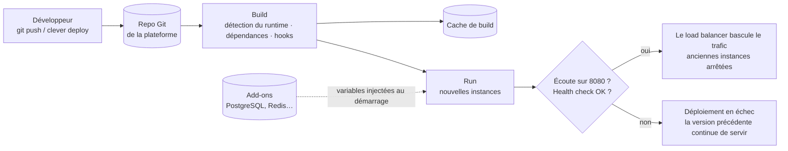
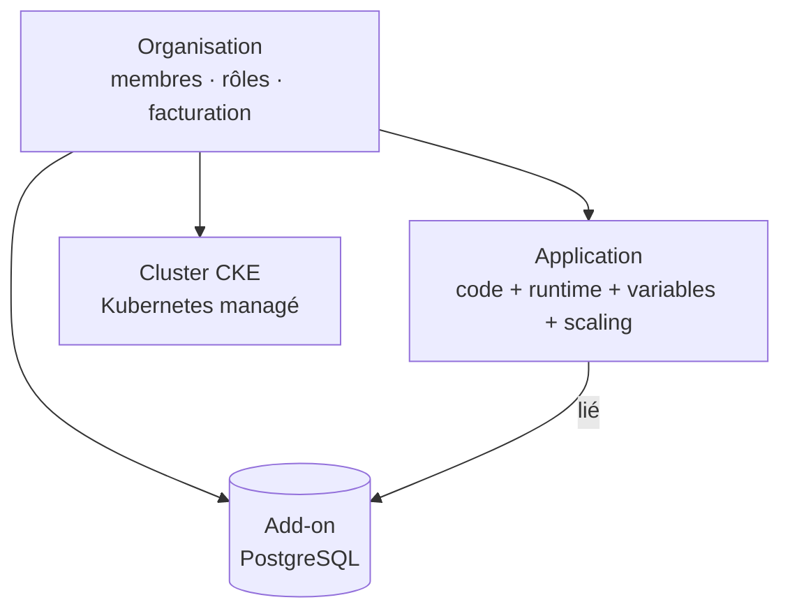

# Workshop développeurs — Continuer l'aventure Clever Cloud

Deux heures pour passer de « j'ai un compte » à « je déploie, je connecte une base, et je sais lire ce qui casse ».

**Durée :** 2 h, en ligne · **Public :** développeurs, débutants ou non sur Clever Cloud · **Format :** démo en direct, à suivre en même temps si vous voulez, ou à refaire après avec le [lab](lab.md)

## Contenu

| | |
|---|---|
| [`prerequisites.md`](prerequisites.md) | Ce qu'il faut pour suivre en direct (facultatif : vous pouvez aussi juste regarder) |
| [`lab.md`](lab.md) | Le pas-à-pas complet, pour suivre ou refaire après |
| [`slides/`](slides/) | Les slides (PDF) |
| [`demos/`](demos/) | Les applications utilisées (voir [`demos/README.md`](demos/README.md)) |

## Objectifs

À la fin du workshop, vous savez :

1. Expliquer ce que fait la plateforme et ce qui reste à votre charge (modèle PaaS).
2. Décrire le cycle de déploiement : push → build → run → health check → bascule du trafic.
3. Créer, configurer, déployer et mettre à jour une application avec Clever Tools, et vous repérer dans la Console.
4. Créer un add-on PostgreSQL, le lier à votre app et comprendre comment ses identifiants arrivent jusqu'à elle.
5. Diagnostiquer seul deux pannes classiques : un build qui échoue, une base qui refuse les connexions.
6. Situer les options pour aller plus loin : déploiement moderne (uv), scalabilité, domaines, Kubernetes managé (CKE).

## Programme

1. Accueil, création de compte
2. Le modèle mental : qui fait quoi, cycle de déploiement
3. **Partie 1** — Déployer une app Python, lire le log, livrer une nouvelle version sans coupure
4. **Partie 2** — Add-ons : créer une base PostgreSQL, la lier à l'app
5. **Partie 3** — Quand ça casse : « ma nouvelle version n'est pas en ligne », « ça marche, puis ça plante »
6. **Partie 4** — Une app moderne : Django + uv + PostgreSQL (démo)
7. **Partie 5** — Aller plus loin : catalogue, scalabilité, domaines, Kubernetes (démo)
8. Vos projets : questions-réponses, crédits

## Messages clés

1. **Vous gardez le code, la configuration et les données ; la plateforme fait le reste** : OS, runtime, build, load balancing, TLS, scaling.
2. **Chaque déploiement crée de nouvelles instances ; les anciennes sont jetées.** Rien de ce qui est écrit sur le disque local ne survit : l'état vit dans les add-ons.
3. **Configuration = variables d'environnement** : les vôtres, celles de la plateforme (`CC_*`), et celles injectées par les add-ons liés. Elles sont lues au démarrage : après un changement, il faut redémarrer.
4. **Zéro coupure grâce au blue/green** : les nouvelles instances démarrent et passent le health check avant de recevoir le trafic. Un build raté ne casse pas la prod.
5. **Le log raconte l'histoire** : le log de déploiement pour ce qui se passe avant le démarrage, les logs applicatifs pour la suite. Lisez l'erreur jusqu'au bout.
6. **Un redémarrage n'est pas un correctif.** S'il « répare » pour un moment, la cause est encore là.

## Qui fait quoi

| | Vous | La plateforme |
|---|---|---|
| Code, dépendances | ✅ | |
| Configuration (variables d'environnement) | ✅ | injecte les `CC_*` et celles des add-ons |
| Build, démarrage, health check | | ✅ |
| OS, runtime, mises à jour de sécurité | | ✅ |
| Load balancing, TLS, domaines | vous choisissez les domaines | ✅ |
| Scaling | vous fixez les bornes | ✅ |
| Données | vos données | ✅ bases managées (add-ons) |

## Cycle de déploiement

## Ressources

## Documentation

- Documentation Clever Cloud : <https://www.clever.cloud/developers/doc/>
- Clever Tools (CLI) : <https://www.clever.cloud/developers/doc/cli-reference/>
- Runtime Python : <https://www.clever.cloud/developers/doc/deploy/applications/python/> · avec uv : <https://www.clever.cloud/developers/doc/deploy/applications/python/uv/>
- Kubernetes (CKE) : <https://www.clever.cloud/developers/doc/deploy/kubernetes/>
